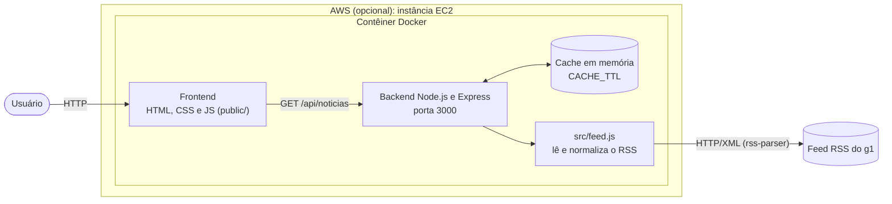
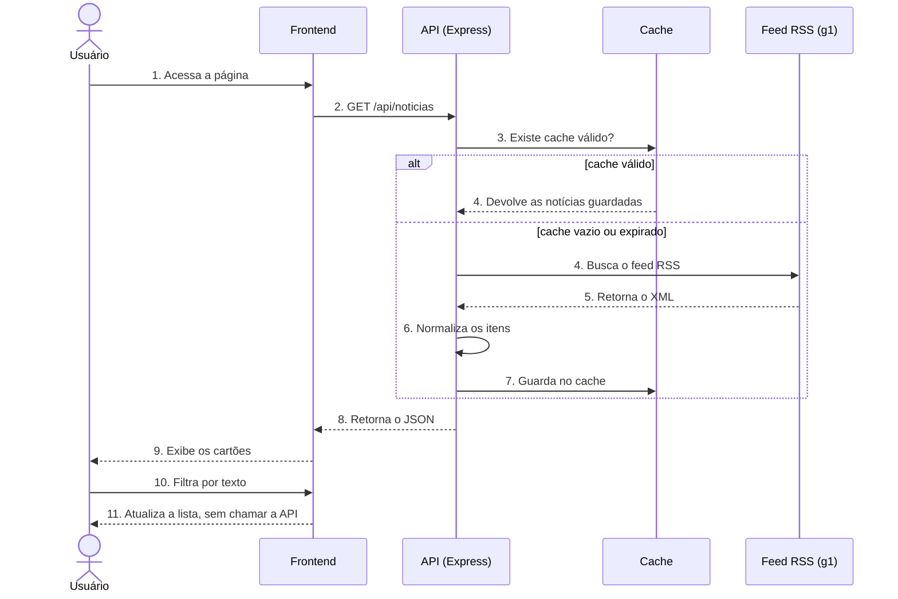

# Feed de Notícias RSS

Aplicação web que lê um feed RSS (por padrão, o do g1) e mostra as notícias em uma página responsiva, com filtro por texto e tema claro/escuro automático. O back-end é uma API em Node.js/Express com cache em memória, e o projeto roda em Docker.

> Inspirado em um projeto em equipe que desenvolvi durante o programa da Compass UOL. Esta é uma implementação independente, escrita do zero.

## Funcionalidades

- Leitura e normalização de feed RSS (título, resumo, imagem, data e link da matéria original)
- API REST `GET /api/noticias` com limite configurável
- Cache em memória com tempo de expiração; se o feed cair, a última versão guardada continua sendo servida
- Interface responsiva, com filtro, botão de atualizar e suporte a tema claro/escuro
- Execução com Docker ou direto com Node.js
- Testes automatizados com `node:test`

## Tecnologias

Node.js, Express, rss-parser, HTML, CSS, JavaScript, Docker e Docker Compose.

## Diagramas

### Visão geral



Variáveis de ambiente do backend: `PORT`, `FEED_URL` e `CACHE_TTL`.

| Componente | Descrição |
| --- | --- |
| Frontend | Página estática servida pelo próprio Express, com filtro feito no navegador |
| Backend | API Node.js/Express na porta 3000, com cache em memória |
| `src/feed.js` | Busca o feed, limpa o HTML e devolve título, resumo, imagem, data e link |
| Feed RSS | Fonte externa das notícias (por padrão, o g1) |

### Fluxo de uma requisição



Se o feed estiver fora do ar e já existir uma versão guardada, a API devolve essa versão com `desatualizado: true`. Se não houver nada guardado, responde com erro 502.

## Como rodar

### Opção 1: Node.js

Requer Node.js 18 ou superior.

```bash
git clone https://github.com/Jotavsts/feed-noticias-rss.git
cd feed-noticias-rss
npm install
npm start
```

Abra http://localhost:3000.

### Opção 2: Docker

```bash
git clone https://github.com/Jotavsts/feed-noticias-rss.git
cd feed-noticias-rss
docker compose up --build
```

Abra http://localhost:3000.

### Opção 3: AWS (EC2)

O mesmo contêiner pode rodar em uma instância EC2. Passo a passo básico:

1. No console da AWS, crie uma instância **EC2** com Amazon Linux 2023 (uma `t3.micro` basta).
2. No **Security Group**, libere a porta **80** (HTTP) para qualquer origem e a porta **22** (SSH) apenas para o seu IP.
3. Conecte por SSH e instale o Docker e o Git:

   ```bash
   sudo dnf install -y docker git
   sudo systemctl enable --now docker
   ```

4. Clone o projeto, gere a imagem e suba o contêiner na porta 80:

   ```bash
   git clone https://github.com/Jotavsts/feed-noticias-rss.git
   cd feed-noticias-rss
   sudo docker build -t feed-noticias-rss .
   sudo docker run -d --name feed --restart unless-stopped -p 80:3000 feed-noticias-rss
   ```

5. Acesse `http://IP-PUBLICO-DA-INSTANCIA`.

Atenção aos custos: crie um alerta no **AWS Budgets** antes de subir a instância e encerre-a quando terminar de testar.

## Configuração

As variáveis são opcionais. Copie `.env.example` e ajuste, se quiser.

| Variável | Padrão | Descrição |
| --- | --- | --- |
| `PORT` | `3000` | Porta do servidor |
| `FEED_URL` | `https://g1.globo.com/rss/g1/` | URL do feed RSS |
| `CACHE_TTL` | `300` | Tempo de cache, em segundos |

## API

`GET /api/noticias?limite=30` devolve:

```json
{
  "fonte": "g1",
  "total": 30,
  "doCache": false,
  "desatualizado": false,
  "noticias": [
    {
      "titulo": "...",
      "resumo": "...",
      "link": "https://...",
      "imagem": "https://...",
      "publicadoEm": "2026-10-30T12:00:00.000Z"
    }
  ]
}
```

`GET /saude` devolve `{ "status": "ok" }` e é usado no healthcheck do Docker.

## Testes

```bash
npm test
```

## Estrutura

```
.
├── public/            # interface (HTML, CSS e JavaScript)
├── src/feed.js        # leitura e normalização do RSS
├── tests/             # testes automatizados
├── server.js          # servidor Express e API
├── Dockerfile
└── docker-compose.yml
```

## Aviso

As notícias pertencem aos respectivos veículos. A aplicação mostra apenas título, resumo curto e imagem de capa, com link para a matéria completa na fonte.

## Licença

MIT. Veja o arquivo [LICENSE](LICENSE).
